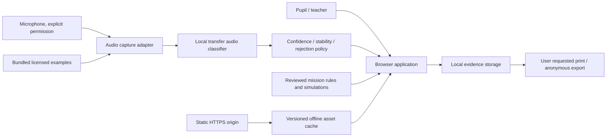

# Proposed architecture and development framework

Status: proposed; not installed, implemented or benchmarked. See ADRs for tradeoffs and POC for verification.

## System boundaries

No backend, login, third-party analytics or audio-upload route in MVP. Initial installation/asset loading uses the selected host; microphone samples stay in browser memory. Hosting access logs may exist, so “no audio upload” must not become “no network metadata ever”. Use an explicit audio start/stop lifecycle; stop all tracks on stop, route exit, hidden tab and reset. Never monitor silently while pupils work on another mission.

## Proposed stack

React + TypeScript + Vite for static build and typed interaction states; Web Audio API for analysis/playback; TensorFlow.js plus speech-commands transfer-learning candidate for local classification; IndexedDB for versioned anonymous evidence and model cache where appropriate; a service worker for a tested offline asset manifest. Plain CSS or a small existing component set; avoid introducing a large UI system solely for four missions. Vitest for meaningful domain/state tests, Playwright for browser flows where permitted, and axe-core plus manual accessibility checks. Pin actual compatible versions only during approved POC; no package manifest exists yet.

Official transfer-learning tutorials support the feasibility of browser classification, not suitability for these three classes: [TensorFlow](https://www.tensorflow.org/js/tutorials/transfer/audio_recognizer), [Google codelab](https://codelabs.developers.google.com/codelabs/tensorflowjs-audio-codelab).

## Planned modules and contracts

| Module | Responsibility | Boundary |
|---|---|---|
| App shell / navigation | Setup, mission routing, resume, mode banner | Must not calculate model results |
| Audio adapter | One capture stream; user gesture playback; PCM conversion | Reports permission/device errors; no persistence of raw audio |
| Classifier adapter | Load approved model; normalize expected input; return scores | No correctness or mastery judgments |
| Decision policy | Reject unknown/low-confidence/mixed input; stabilize prediction | Versioned thresholds fixed before holdout test |
| Mission engine | Predict/observe/explain/revise transitions | Rules independent of sensor success |
| Content catalogue | BM copy, examples, hint rules, assessment tags | Reviewed by teacher; no remote generative text |
| Evidence store | Transactional saves, schema migration, erase/export | No unrequested device-to-device sync |
| Cache manager | Offline readiness, model/content version agreement | No silent partial update during a live investigation |

Classifier result specification: request ID, source mode (live or example), class label or unknown, score vector, elapsed time, model version, policy version and quality flag. Scores are similarity/confidence outputs, not calibrated likelihoods. Quality flags distinguish silence, clipping, ambient/mixed input, inference failure and accepted input. UI ignores results for an obsolete request after stop/navigation.

Evidence specification: schema version, anonymous session ID, mission ID, content version, original prediction, action/condition, observation, explanation, revision, hint count, source mode, model/policy version if applicable, timestamp and teacher note. Store structured facts, never inferred personal attributes. Demonstration records use a separate namespace and are excluded from pupil exports by default.

## State model

Session: new → setup → active → report → archived locally or erased. Mission: intro → predicted → experiment ready → active → observation → explanation → complete; revision opens a new attempt while keeping the first prediction. Audio state: idle → permission pending → ready → capturing → processing → accepted/uncertain/error → stopped. All active states can cancel; no mic permission or AI confidence condition permanently blocks a mission.

Duplicate clicks cannot create duplicate attempts. Backgrounding stops capture and returns a recoverable state. Save failure shows “Belum disimpan” and offers print/export; never claim a save succeeded from an optimistic spinner. Migrations are versioned; preserve old export compatibility or offer a clear migration/reset decision.

## Asset and offline strategy

Bundle approved model topology, weights, label map, transfer-head metadata, audio examples, fonts and mission content from the same origin. Confirm base-model artifact licensing and redistribution terms before bundling. No CDN request may be required during an offline demo. Never assume a training export includes every base-model dependency.

Cache readiness requires opening all four missions, reading every required asset, loading model and completing one sample inference. Test with network disabled and browser restarted, then verify no network-dependent path. First-ever offline visit is unsupported. A prepared localhost presenter bundle is the backup, using the exact verified build and model. File double-click deployment is unsupported. HTTPS or localhost and explicit microphone permission are required by the planned design; browser restrictions described by [MDN](https://developer.mozilla.org/en-US/docs/Web/API/MediaDevices/getUserMedia).

## Delivery workflow after approval

Create a POC branch and bounded PR; record real measurements. After gate review and product approval, use one scoped issue per small feature branch. Each PR describes behavior, linked acceptance IDs, changed ADRs and evidence. CI should later check types, domain tests and build; browser/hardware and teacher checks remain explicit release criteria. Do not add empty CI now and imply it passed.

Security controls planned: no secret/API key needed, no raw audio logging, no free-form HTML rendering from pupil text, bounded text inputs, validate imported/exported structures if import is later added. CSP and microphone permissions policy evaluated for the actual host. No cloud AI/provider integration is planned; adding one needs an ADR, privacy review and separate approval.
