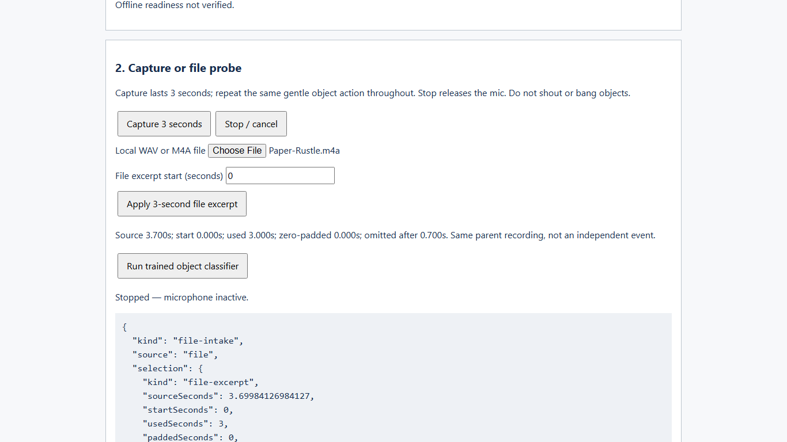
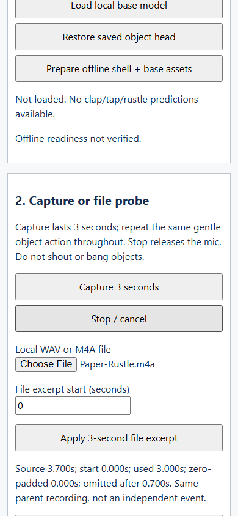

# Adult recording intake — 25 October 2026

**Status: actual recordings ingested and feature path verified; CONDITIONAL / HOLD for product development.** This supersedes the initial checkpoint's statement that no recordings were supplied. It does not supersede the accuracy gates or grant product approval.

Code under test: `fd9f00dec9290458304e7c4268cd3693251c3885`, branch `poc/technical-feasibility`, [draft PR #17](https://github.com/lauhoekeat/ai-soundlab/pull/17). This is additional work within the existing bounded technical POC. No extension, product work or deployment was authorized or performed.

## Supplied sources and provenance

The owner supplied four local M4A files and confirmed they were made by an adult using the same device in the same room. Exact recording session, device model and test browser were not specified. The unknown recording includes bed/head taps and intentional adult random voice, per the owner. No speech transcription, identification or personal-attribute inference was performed. All four are initial development/intake sources, not a final locked holdout.

| Anonymous source | Owner's label | Decoded duration | Probe selection at start 0 | Relative RMS / clipping fraction |
|---|---|---:|---|---|
| source-01 | Clap | 2.771791 s | 2.771791 s used + 0.228209 s zero padding | 0.006260 / 0 |
| source-02 | Pencil tap | 4.089025 s | First 3 s; 1.089025 s omitted after | 0.001996 / 0 |
| source-03 | Paper rustle | 3.699841 s | First 3 s; 0.699841 s omitted after | 0.011146 / 0 |
| source-04 | Unknown | 8.306644 s | First 3 s; 5.306644 s omitted after | 0.015467 / 0 |

All decoded buffers had two channels at 44.1 kHz; the shared intake path downmixed to mono. RMS values refer to the selected padded/cropped probe, not calibrated dB SPL or full-recording safety measurements. No selected sample reached the clipping threshold (absolute amplitude ≥0.99). Pencil-tap level is relatively low and near the candidate silence threshold; do not change that threshold from these four files or claim a validated sensitivity.

Source SHA-256 fingerprints, byte counts and exact selection metadata are in [pipeline-checks.json](2026-10-25-adult-intake/pipeline-checks.json). Original files were not changed. Temporary decoded WAV copies remain local outside the Git checkout; neither original nor decoded audio is committed or uploaded. The adult voice portion remains local. Screenshots and JSON contain numeric summaries only, not waveform/audio data.

## Changes required to use the recordings

The diagnostic initially selected only WAVs and required a 2.8–3.2-second buffer for the model. The supplied clap is slightly shorter; the other recordings are longer. The file probe now accepts browser-decodable M4A or WAV, displays original duration, selects an explicit three-second excerpt and reports zero padding and omitted ranges. A user can change the start offset. Invalid offsets invalidate the pending audio rather than leaving a stale classified sample.

Numeric intake evidence now records the crop/padding/source mode when saved/exported, without storing audio or source filenames. Training input validation is unchanged: the manifest still requires independently prepared three-second WAV events and provenance. Selecting a probe never trains a model or turns overlapping excerpts into independent events. Excerpts do not alter the classification policy.

## Measured checks

On Windows 11 with Playwright Chromium headless 145.0.7632.6, the flow under test was main diagnostic → choose actual M4A → inspect default excerpt → reject classification while no head exists → extract actual pretrained base features through the diagnostic driver. All four supplied files decoded and each selected probe produced three finite 2000-element embedding vectors. This establishes numerical compatibility, not that the features distinguish the classes.

An explicit 0.5-second paper-rustle offset worked, an offset beyond the file was rejected, and recovery to offset 0 worked. All recorded browser requests were same-origin GETs to loopback; audio bytes entered through the local file/automation API, never an HTTP upload. No page errors or horizontal overflow were observed at 1366×768 and 390×844. No framework error overlay appeared; screenshots were inspected. Browser plugin/skill was absent; regular Playwright was the recorded testing fallback.

Twenty warm **base-embedding-only** passes (five per supplied source) had nearest-rank p95 **151.2 ms** in this run. This excludes file decoding, capture, a learned head, policy and result rendering, and is not the G3 end-to-end latency measurement.

A short persistent browser profile was prepared, the browser process closed, and a new process launched with network disabled. Each actual supplied M4A decoded and produced finite base embeddings offline. No object head was present and no object prediction was performed. See [offline-checks.json](2026-10-25-adult-intake/offline-checks.json).

TypeScript/build passed; 20 unit tests across four files and all 11 browser regression checks passed. New tests cover explicit padding/crop metadata, save/reload of numeric selection provenance, and invalid-offset stale-audio prevention. An initial new browser test read saved output before the async reload completed; it was corrected to await the visible result, then the full suite passed. No model tuning was performed to obtain these passes. See [regression-checks.json](2026-10-25-adult-intake/regression-checks.json) and [build fingerprints](2026-10-25-adult-intake/build-manifest.json).

## What has not been measured

No adult object head was fitted. We have one parent file per target class and one mixed unknown file. There is no dedicated background training source, independently split training/development/test corpus, held-out room/device/contributor, live two-device trial or confusion matrix. Fitting on these files and testing on crops of the same recordings would not establish generalization; the train/test separation guard was not weakened. Unknown was not relabelled as the trained background class to fill the missing data.

| Gate | Latest status |
|---|---|
| G1 physical capture | Still partial: synthetic lifecycle checked earlier; real two-device mic operation pending |
| G2 object accuracy/rejection | NOT RUN: intake/feature checks do not count as recognition trials |
| G3 latency | Partial: actual-file base timing available, complete object-inference timings pending |
| G4 offline/privacy | Partial: actual-file decode/base features verified after offline restart; real trained head plus real object inference and physical capture audit pending |
| G5 teaching | NOT RUN; no pupil interface or classroom pilot |
| G6 product decision | HOLD; no GO or product authorization |

Pretrained base/hash/licensing limitations from the [initial report](poc-2026-10-25.md) remain. No binary model distribution or license claim was added. Common preprocessing is still a candidate and needs real classifier evaluation.

## Next recording batch

For an initial trained pipeline run, we need **at least two separately recorded takes of each target** (clap, pencil tap, paper rustle) and **at least two background takes** (ordinary quiet room/fan without deliberate target sounds). The current files can provide one target source each after documented three-second conversion. Thus the smallest next batch is **five fresh recordings: one new three-second take of each target plus two background takes**. This is only the software training floor, not enough for a reliable accuracy claim. Keep the current mixed unknown source for development negatives; do not use it to manufacture a background class.

For the actual G2 decision, collect the larger dataset and independent locked test in [AI data plan](../04-ai-data-plan.md): ≥20 independent test events per target plus ≥60 negatives, with source-session separation and held-out contributor/device/room. Keep fresh test recordings completely separate from training. Live two-device/noise trials remain required. Confirm device/browser/version before those trials. Do not create “new” test cases by cropping or re-encoding a training recording.

Keep recordings local or attach them through this chat, with anonymous labels/session/device/room codes. No pupil voices are needed. Scope remains the approved POC; the four student missions and visual directions remain unbuilt/unselected.

## Probe screenshots

These show actual file selection and recorded excerpt provenance in a developer diagnostic, not a validated object prediction.

