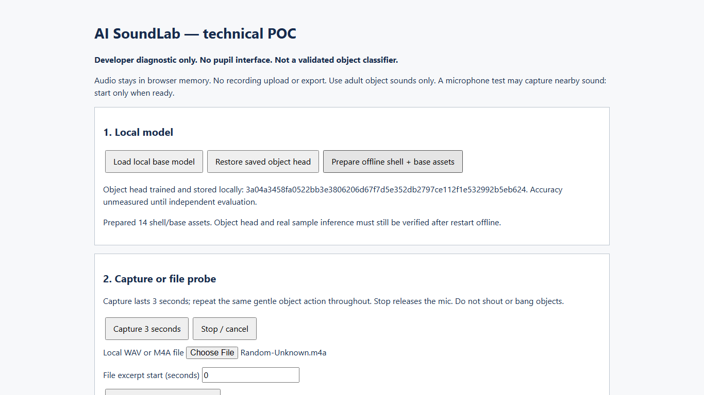

# First actual trained head — 25 October 2026

**Status: exploratory model trained and offline restore verified; CONDITIONAL / HOLD for product development.** This supersedes earlier checkpoints' statements that no actual object head has been fitted. Independent recognition accuracy remains unmeasured. No product development or deployment has started.

Runtime source: `fd9f00dec9290458304e7c4268cd3693251c3885`, unchanged from the intake checkpoint. Training used the existing diagnostic controls and fixed candidate policy, not a new student interface. The last runtime regression remains 20 unit tests and 11 browser checks passed; no runtime/dependency edits were made for this fit. This work is within the existing six-hour POC scope.

## New recordings and confirmed content

Five additional M4As were supplied in response to the requested next training batch. The owner clarified that Random-Unknown-2 contains fan noise, footsteps/stomping and talking, and Random-Unknown-3 contains shower sound. These are two distinct **non-target noise** training sources; they are not clean quiet-room/fan-only recordings. Only their first three seconds were selected, so no claim is made that each selected excerpt includes every sound listed for its full source.

The new batch was supplied in the adult-only POC context. Exact per-file adult/contributor/device/room/session metadata was not separately reconfirmed; no new held-out condition is inferred. All training events use anonymous `unconfirmed` metadata and one conservative grouping. First-batch same-room/device confirmation remains historical and is not extended to a second device.

| New source | Owner-described purpose | Decoded duration | Start-0 preparation |
|---|---|---:|---|
| Pencil-Tap-2 | Pencil tap | 3.142381 s | First 3 s, 0.142381 s omitted |
| Paper-Rustle-2 | Paper rustle | 4.527324 s | First 3 s, 1.527324 s omitted |
| Random-Unknown-2 | Mixed fan/feet/talking; non-target noise | 12.090204 s | First 3 s, 9.090204 s omitted |
| Random-Unknown-3 | Shower; non-target noise | 9.437506 s | First 3 s, 6.437506 s omitted |
| Adult-Clap-2 | Clap | 2.875465 s | 0.124535 s zero padding |

All five decoded, produced finite 3×2000 base features and had zero clipped samples in their selected probes. Original files remain unchanged and outside Git. M4A fingerprints and exact values are in [batch2-intake.json](2026-10-25-first-fit/batch2-intake.json).

## Actual training

Eight parent recordings entered training: the original and second take for each of clap, pencil tap and paper rustle, plus the two new confirmed non-target noise sources. Each yielded three correlated temporal windows, giving 24 feature vectors. These are **eight recordings, not 24 independent events**. Original Random-Unknown was excluded from fitting and used only as an initial same-condition diagnostic negative. It is not a locked holdout.

Each first-three-second excerpt was converted locally to a float WAV with explicit crop/padding metadata. The normal manifest checks, exact decoded-content duplicate check, train-only filtering and two-source-per-class floor were exercised through the diagnostic UI. All eight manifest records were `train`; there was no development/test split. The diagnostic refused Run locked test with “No events in requested split”; no locked test result was manufactured.

Training kept existing settings: frozen base `dense_1` embeddings, four-class softmax head, Glorot seed 20261025, Adam 0.001, 25 epochs, batch size 16, shuffle false. Policy remained `candidate-1-not-validated` (score 0.80, margin 0.20, three stable windows, existing signal checks). There was no threshold adjustment, repeated model search or tuning against the original Unknown file.

Actual head hash: `3a04a3458fa0522bb3e3806206d67f7d5e352db2797ce112f1e532992b5eb624`. Base/preprocessing/manifest fingerprints, source transformations, scores and trial timing are in [first-fit.json](2026-10-25-first-fit/first-fit.json). [Manifest metadata](2026-10-25-first-fit/training-manifest-metadata-only.json) is committed without any audio. The [model card](2026-10-25-first-fit/model-card.md) records limitations.

## Results — fit diagnostics only

| Check | Observed result | Interpretation |
|---|---|---|
| Replay 2 training clap sources | Both labelled clap | Training resubstitution, not test accuracy |
| Replay 2 training pencil sources | Both labelled pencil-tap | Training resubstitution, not test accuracy |
| Replay 2 training paper sources | Both labelled paper-rustle | Training resubstitution, not test accuracy |
| Replay 2 training non-target sources | Both rejected as unknown, reason background | Training resubstitution; no general noise-rejection claim |
| Original Unknown, first 3 s, excluded from fitting | Rejected as unknown, low score/margin | One non-independent development probe, not a false-acceptance estimate |
| Full browser process restart, network disabled | Base and actual head restored; training clap inference labelled clap | Real trained-head/offline plumbing verified on one headless environment |

No independent confusion matrix, target accuracy or population false-acceptance rate is reported. A perfect fit to eight training recordings cannot establish generalization. The original mixed Unknown file is a single initial development source and its full 8.3 seconds were not evaluated as multiple independent trials.

Twenty repeated inference passes on the reused training clap had nearest-rank warm p95 **113.9 ms**, excluding decode/capture/rendering. This includes base features, actual head and rejection computation, but is not G3's two-device capture-finish-to-visible-result measurement. No model latency guarantee is made for the user's installed browser or second device.

All recorded network requests were loopback same-origin GETs. File bytes entered locally and were not sent over HTTP. No browser page errors were recorded. No raw audio or learned model binary was committed or distributed.

## Local state and reproducibility

The learned head is stored in the isolated short browser profile used for this measurement, not automatically in the owner's already-open in-app browser session. The prepared WAVs and exact manifest remain in the local working area outside Git. The repository contains only metadata, scores, hashes, a screenshot and this report. Do not claim the user's currently open tab has a trained head.

To reproduce locally: prepare one documented three-second WAV per listed source; use the eight train records and fingerprints in the metadata manifest; load the base, import the manifest and eight WAVs, Train head from train split; replay sources for clearly labelled fit checks; keep original Unknown outside training; prepare offline cache; restart the same browser profile with network disabled; Load base → Restore saved object head → choose a training WAV → Run classifier. Exact source hashes and transformations are retained so these steps are reviewable without distributing audio. New independent evaluation must use fresh recordings and remain separate from these data.

## Gate decision and next step

G1 remains partial: actual two-device physical mic lifecycle and user-browser tests are pending. G2 remains NOT RUN: no independent held-out event set or noisy live trials. G3 remains partial: actual-head compute timing is measured, complete two-device rendered latency is not. G4's actual trained-head/sample offline restart path is now verified in headless Chromium, while actual physical capture audit and second-device verification remain pending. G5 teacher/pupil checks are unrun. G6 stays HOLD; there is no product authorization.

Next evidence should be **fresh recordings from another device/room, preferably another adult**, reserved entirely for testing. Do not ask for more copies of the same training recordings or count cropped windows as independent tests. The approved decision gate still calls for ≥20 independent test events per target and ≥60 negative events, plus the two-device live/noise trials. These may be collected as separately marked non-overlapping events in longer takes; event boundaries and session grouping must be documented, not invented from overlapping windows. A small fresh batch may reveal obvious failures early but does not satisfy the full gate.

Smallest eventual product recommendation is unchanged: four distinct inquiry tasks, one supervised capture station, explicit uncertainty/sample mode, local evidence and offline backup—only after gate review and explicit product approval. Competition registration and upload-cutoff verification remain separate owner actions.

