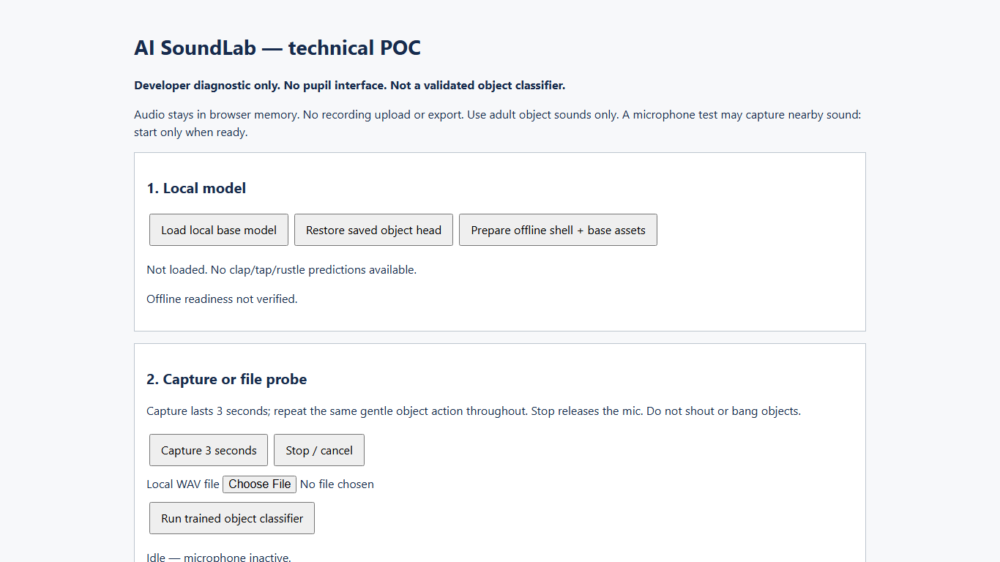
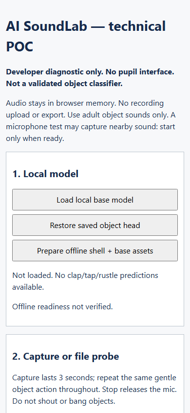

# POC checkpoint — 25 October 2026

**Decision: CONDITIONAL / HOLD for product development.** The local diagnostic mechanisms are implemented and software-tested. The real object-sound classifier has not been validated: no adult recordings have been supplied yet. This is not a passing POC or evidence of classroom accuracy. Product development and deployment remain unapproved.

Source under test: `cee766175d038198c382d7a74eb04d80e3da1159`, branch `poc/technical-feasibility`. Approval is quoted in [ledger](../approvals.md). Work stayed within the six-hour POC allowance; the first recorded clock was 16:59 MYT and software evidence completed approximately 17:16 MYT, including setup/testing. The full six-hour allowance has not been spent. Do not consume the remaining time expanding into product work while adult input is pending.

## Outcome and remaining gate status

| Gate | Result | Evidence / what remains |
|---|---|---|
| G0 | PARTIAL | Explicit POC approval and Windows target confirmed; exact installed browser/second-device details and competition submission requirements pending |
| G1 capture | PARTIAL | Five synthetic-media capture cycles, injected denial/missing/busy errors, cancel-pending/late-grant release passed; actual two-device microphones not tested |
| G2 AI utility | NOT RUN | Adult dataset events: 0 supplied; training/development/locked test: 0; live object trials: 0. No accuracy, coverage or false-acceptance estimate exists |
| G3 responsiveness | PARTIAL | 20 warm runs with generated signal + synthetic QA head recorded; actual target-device object head and connection timing not established |
| G4 offline/privacy | PARTIAL | Hashed local assets, offline navigation and complete Chromium process restart followed by restored synthetic head inference passed. Observed requests in fixture tests were same-origin GET only; no upload. Real imported object sample/network and physical capture checks still required |
| G5 educational | NOT RUN | No teacher content signoff or permitted pupil pilot. No M1 pupil interface was built |
| G6 decision | HOLD | Owner product approval absent; keep #3–#5 open for real evidence; #6 is not ready for GO |

Raw confusion matrix is **unavailable**, not an empty matrix represented as 100% accuracy. No adult object model, validated policy or live classification recording is delivered at this checkpoint. A ≤90s unedited real success/failure capture remains pending with the target-device run.

## What is implemented

Developer-only TypeScript/Vite diagnostic: explicit three-second AudioWorklet capture; stop/cancel/late-permission release; local WAV decode; common mono/resample/spectrum frontend; real pretrained embedding; local four-class head training; score/margin/stability/quality rejection; adult manifest validation; event/session/content duplicate checks; train-only fitting and one-use locked test guard; numeric evidence save/reload/export; saved-head restore; hashed complete offline asset cache.

No four-mission product, student-facing UI, chatbot, API key, backend, teacher dashboard or deployment was added. The original per-feature briefs remain intact. The test fixture is separately labelled synthetic and exposes no production student experience.

## Verification and measurements

See [software-checks.json](2026-10-25/software-checks.json) for sanitized actual results, trial timings and network requests; [build manifest](2026-10-25/build-manifest.json) for artifact hashes; [base manifest](2026-10-25/base-artifacts.json) for source artifact hashes. Results are a local run, not GitHub CI results.

- TypeScript check and production build passed. Build retains an approximately 894 kB uncompressed TensorFlow/shared chunk; this is an acknowledged POC size warning, not a failed build.
- 17 unit tests in three files passed: policy/rejection, denominator-aware metrics, manifest/leakage checks, preprocessing/resampling.
- Nine browser checks passed: identity/rendering/no overlay, main-page console exception check, save/reload and storage-error state, desktop/narrow layout, generated WAV path, synthetic capture cycles, permission/error injection, actual base embedding and synthetic head serialization, offline page load and full browser process restart.
- Final synthetic fixture measurements: base load/integrity check 499.5 ms; warm inference nearest-rank p95 259.6 ms over 20 runs (excludes capture); pending-permission cancellation/late-track check 25.1 ms. These are this headless test environment's measurements, not real object-classifier gate results. Per-run values are recorded in JSON.
- Generated float WAV and direct generated PCM produced identical embeddings in the measured test (maximum absolute difference 0). This verifies the deterministic common path for this fixture only, not equivalence to physical mic/OS processing.
- Dependency audit after updating Vitest to 4.1.12 reported zero known vulnerabilities on this run. It is a dated dependency result, not a guarantee.

Environment: Windows 11 Home Single Language 10.0.26200 x64, Node 24.14.0, npm 11.9.0, Playwright Chromium headless 145.0.7632.6. Browser plugin/skill was absent; regular Playwright fallback used per frontend testing guidance. Views: 1366×768 and 390×844. No installed user Chrome/Edge, real second device or venue network benchmark was performed. Screenshots were inspected; plain diagnostic controls and text are readable at both widths, with no horizontal overflow. Full product design/accessibility acceptance remains untested.

## Failures encountered and corrections

1. Initial dependency selection included known Vitest advisories; moved to patched 4.1.12 and audited again before delivery.
2. Offline asset collection initially needed the complete built dependency graph, not only the entry script. The worker now verifies the build manifest and all base artifacts, then switches a cache pointer only after the complete set is prepared.
3. Chromium persistent-profile restart test failed to register a service worker under a long workspace/test path. Repeating with a short OS temporary profile path passed. Long-path test-profile behavior remains an environment limitation; no general browser/path compatibility claim is made.
4. Storage save failure could leave a stale earlier saved label. Added explicit saving/failed states and an injected-quota test. Final test passes.
5. One intermediate build hit a TypeScript error in a new test selector; the shell continued tests against the previous build. Those two stale-build failures are not used as final evidence. The selector was corrected and subsequent verification stopped on build failures, rebuilt and passed the entire final suite.

## Model/data provenance and licenses

Base: official TensorFlow speech-commands `v0.4/browser_fft/18w` topology/weights, fetched from Google's published storage. Source URLs, sizes and SHA-256 are recorded; downloader pins all four expected digests. Model topology is 43×232×1 and the real `dense_1` layer provides 2000-element embeddings. It was trained for English speech commands; it cannot directly identify clap/tap/rustle. [Upstream API/source](https://github.com/tensorflow/tfjs-models/tree/master/speech-commands) documents the model family. Only original implementation code was added here; upstream code was not copied into this project.

Adult transfer head: **none trained**. Automated fitting/serialization tests use artificial feature vectors under `synthetic-software-test-not-adult-data`; generated sine-wave WAVs test signal plumbing only. These vectors/tones are not adult-created object sounds and contribute zero trials to G2. Test weights remain in isolated test browser storage, not the repository or main diagnostic session. No raw audio is committed, cached, logged or exported.

Direct dependency metadata: TensorFlow.js 4.22.0 Apache-2.0; fft.js 4.0.4 MIT; Vite 8.3.5 MIT; Vitest 4.1.12 MIT; Playwright 1.58.2 Apache-2.0; TypeScript 5.9.3 Apache-2.0. Lockfile pins actual resolved dependencies. Npm source-code license declarations do **not** establish separate pretrained-weight redistribution rights; that review remains open. Downloaded base weights and build output are Git-ignored and no trained model binary is distributed. No general public repository license was chosen for the owner's project.

Known ML limitation: candidate Blackman/no-smoothing deterministic spectrum is not bit-equivalent to the original browser AnalyserNode preprocessing. Spaced windows cover repeated actions; correlated windows are not independent evaluation trials. Validate transfer performance on real events before accepting this frontend. Reject silent/clipped/uncertain input; never silently fall back to canned object labels.

## Exact next evidence needed

1. Confirm browser/version and the actual Windows computer used for the event; specify second device/browser.
2. Supply adult-created three-second WAV events with anonymous class/session/contributor/device/room provenance. Include background/unknown and keep independent train/development/test sessions. Small initial samples can check ingestion, but do not meet the locked evaluation floor.
3. Follow [data plan](../04-ai-data-plan.md): train/development data; locked ≥20 target events per class + ≥60 negatives with held-out contributor/device/room. Live classroom-like trial per two devices: ten attempts per target plus twenty negatives each.
4. Execute real capture/stop cycles, record post-capture p95 over ≥20 runs/device, offline restart with the actual saved head and selected object WAV, and inspect requests/exports. Teacher supplies appropriate content/feasibility review.
5. Record actual confusion matrix and gate decision in this report/PR. Only then ask for the owner's explicit product decision. Use remaining approved POC time; seek an extension only if the actual six-hour cap is reached.

Smallest recommended scope, **if these gates later pass**: keep four simple distinct inquiry workspaces, one supervised live-capture station, one validated three-target classifier plus rejection, explicit sample mode, local notebook/print report and prepared offline backup. Defer accounts, class synchronization, richer art and extra languages. If live noise fails but real sample inference passes, present a clearly labelled sample-first conditional scope for owner review rather than changing the original gates.

Registration remains a separate owner action: closes 26 October per supplied announcement; no registration was submitted here. Artifact upload cutoff remains unverified. Event: 12 November. Do not wait for model evidence to inspect registration requirements.

## Diagnostic screenshots

These show a developer instrument, not an approved student design.

